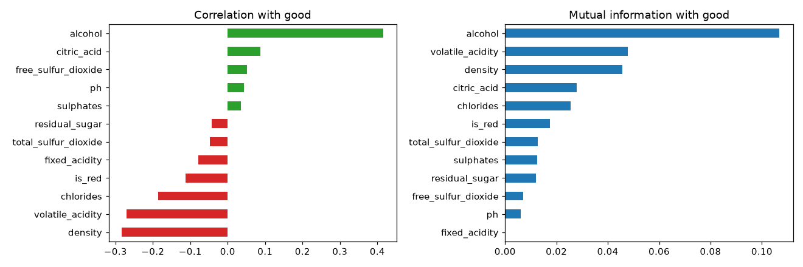

# Wine Quality Prediction (red and white Vinho Verde)

A machine learning project that predicts, from laboratory measurements, whether a wine will be rated **good** by human tasters. The final model is a Random Forest, served as a REST API with Flask/gunicorn and packaged in a Docker container.

## Problem description

Wine producers rate the quality of each batch by sending samples to human tasters. This is slow, expensive and subjective.
Every batch, however, also goes through routine **laboratory measurements** (acidity, sugar, sulphates, alcohol, ...).

**Goal:** predict from 11 lab measurements and the wine type (red or white) whether a wine will be rated **good** (taster score >= 6 out of 10) or **not good** (score <= 5).

**How the model will be used:** as a cheap *pre-screening* tool. A winery sends the lab values of a new batch to the web service and gets back the probability that the batch is good. Batches with a low probability can be flagged for closer inspection by a human expert. The model supports human tasters; it does not replace them.

**Main metric:** ROC AUC (the classes are fairly balanced, about 63% good). Accuracy is reported as a secondary metric.

```
lab measurements  ->  POST /predict  ->  Random Forest  ->  {"good_probability": 0.98, "good": true}
   (JSON)             Flask + gunicorn     (scikit-learn)           (JSON)
                      inside Docker
```

## Dataset

- Physicochemical measurements and taster scores of red and white Vinho Verde wines (Portugal).
- File: `data/wine_quality.csv` (committed to this repository).
- 6497 rows: 4898 white and 1599 red wines; 11 numeric features, a `type` column and the `quality` score (3-9).
- **Missing values:** 38 cells in 7 columns (34 rows, 0.5% of the data). They are filled with the **median of the training data** inside the model pipeline (never with statistics from validation or test data).
- **Duplicates:** 1168 exact duplicate rows are removed (5329 unique wines remain: 3970 white, 1359 red), so the same wine cannot appear in both train and test sets.
- Target: `good = 1` if `quality >= 6`, otherwise `0`. The score `quality` itself is never used as a feature.
- `type` is converted to a numeric feature `is_red` (1 = red, 0 = white).

| Feature | Description |
|---|---|
| fixed_acidity | non-volatile acids (tartaric acid) |
| volatile_acidity | acetic acid; too much gives a vinegar taste |
| citric_acid | adds freshness |
| residual_sugar | sugar left after fermentation |
| chlorides | salt content |
| free_sulfur_dioxide | free SO2, protects against microbes and oxidation |
| total_sulfur_dioxide | free + bound SO2 |
| density | density of the wine |
| ph | acidity level |
| sulphates | wine preservative additive |
| alcohol | alcohol percentage (% by volume) |
| is_red | 1 = red wine, 0 = white wine |

## EDA summary

Full analysis: `notebook.ipynb` (and `eda.py`, which regenerates the figures in `images/`).
The data was split 80% / 20% (stratified, `random_state=1`). All analysis uses only the 80% training part (4263 wines); the 20% test part (1066 wines) is used once, at the end.

- **Target:** 62.6% of wines are good. 65.8% of white wines are good versus 53.3% of red wines.
- **Most important features** (correlation with `good`, mutual information):
  - `alcohol` (+0.42, highest mutual information): better wines have more alcohol.
  - `density` (-0.28) and `volatile_acidity` (-0.27): better wines have lower values.
  - `chlorides` (-0.19).
- Many features have outliers (e.g. `residual_sugar` up to 65.8, `total_sulfur_dioxide` up to 440). They are real measurements, so they were kept; tree-based models are not sensitive to them.
- Some features are strongly related to each other (`free_sulfur_dioxide` vs `total_sulfur_dioxide` +0.72, `density` vs `alcohol` -0.67) and to the wine type (`total_sulfur_dioxide` vs `is_red` -0.69). This matters for linear models.



## Modeling

5-fold stratified cross-validation on the training data (same folds for all models), metric ROC AUC. Imputation and scaling are part of a scikit-learn `Pipeline`, so they are learned only from the training part of each fold. Tuning: `RandomizedSearchCV` (15 / 20 / 30 combinations).

| Model | AUC (default parameters) | AUC (tuned) |
|---|---:|---:|
| Dummy (majority class) | 0.500 | - |
| Logistic regression | 0.810 | 0.810 |
| **Random forest** | 0.838 | **0.840 +- 0.009** |
| XGBoost | 0.817 | 0.839 +- 0.011 |

- Tree-based models beat the linear model: the relation between lab values and quality is non-linear and differs between red and white wines.
- Random forest and XGBoost are practically tied (difference far below the fold-to-fold standard deviation). **Random forest was selected**: highest mean score and the service needs only scikit-learn.
- Final parameters: `n_estimators=300, max_depth=20, min_samples_leaf=2, max_features="sqrt"` (see `results/best_params.json`).

### Result on the untouched test set (evaluated once)

| ROC AUC | Accuracy (threshold 0.5) |
|---:|---:|
| **0.824** | **0.754** |

The test score is a little lower than the cross-validation score, as expected, because the cross-validation data was also used to choose the parameters.

## Project structure

```
data/wine_quality.csv      dataset
data_prep.py               data loading, cleaning and train/test split (shared by all scripts)
eda.py                     EDA script (figures go to images/)
model_selection.py         model comparison and tuning (results go to results/)
notebook.ipynb             EDA, feature importance, model selection and tuning
train.py                   trains the final model, evaluates it on the test set, saves it to model/model.bin
predict.py                 Flask web service
test_service.py            sends real wines from the test set to the running service
Dockerfile                 container for the web service
Dockerfile.offline         optional variant that installs packages from a local wheels/ folder
requirements.txt           runtime dependencies (pinned)
requirements-dev.txt       + dependencies for EDA, tuning and the notebook
```

## How to run

All commands are run from the project root. Python 3.13 was used.

### 1. Local environment

```bash
python -m venv .venv
source .venv/bin/activate              # Windows: .venv\Scripts\activate
pip install -r requirements-dev.txt    # use requirements.txt if you only want to train and serve
```

### 2. Reproduce the analysis

```bash
python eda.py               # figures in images/
python model_selection.py   # about 2-3 minutes; writes results/model_comparison.csv and results/best_params.json
jupyter notebook notebook.ipynb
```

### 3. Train the final model

```bash
python train.py             # prints train/test metrics, saves model/model.bin
```

### 4. Run the web service locally

```bash
python predict.py           # http://localhost:9696
```

### 5. Run with Docker

```bash
docker build -t wine-quality .
docker run -it --rm -p 9696:9696 wine-quality
```

The model is trained while the image is built (`RUN python train.py`), so the container always uses the same library versions that created the model.

## API usage

### `GET /health`

```bash
curl http://localhost:9696/health
# {"status":"ok"}
```

### `POST /predict`

Send the 11 lab measurements and the wine type (`"red"` or `"white"`). A value may be `null`; it is then replaced by the training median.

```bash
curl -X POST -H "Content-Type: application/json" \
  -d '{"type":"white","fixed_acidity":7.0,"volatile_acidity":0.2,"citric_acid":0.36,"residual_sugar":2.0,"chlorides":0.04,"free_sulfur_dioxide":35,"total_sulfur_dioxide":120,"density":0.991,"ph":3.2,"sulphates":0.5,"alcohol":12.5}' \
  http://localhost:9696/predict
# {"good":true,"good_probability":0.9807}
```

`good` is `true` when `good_probability >= 0.5`. Invalid input (missing field, unknown type, non-numeric value) returns HTTP 400 with an error message.

### Test with real wines

With the service running:

```bash
python test_service.py
```

It sends 8 random wines from the test set and prints the predicted probability next to the real label.

## Limitations and next steps

- The labels come from human tasters and are subjective; the model is a pre-screening aid, not a replacement.
- Only Vinho Verde wines from Portugal are in the data; the model should not be used for other wines.
- Accuracy is about 75%, so a wrong call is common; probabilities should be read as a ranking of batches, not as a verdict.
- Not done: cloud deployment, probability calibration, a custom decision threshold depending on the cost of missing a bad batch.